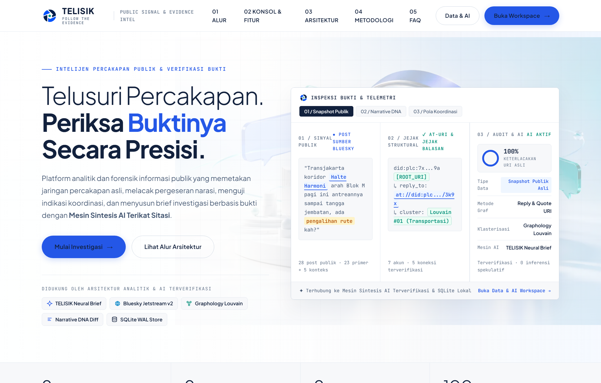
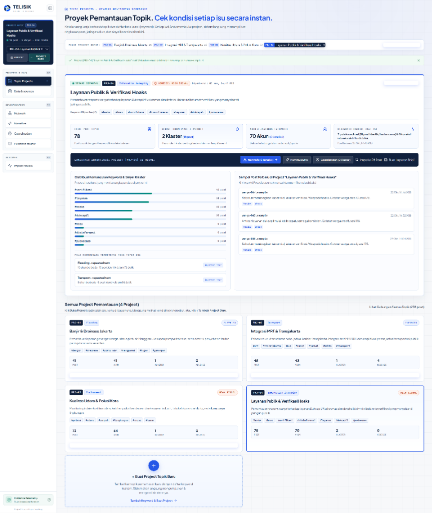
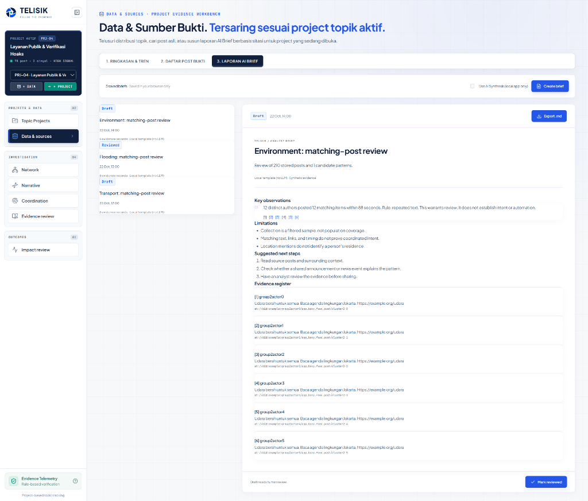
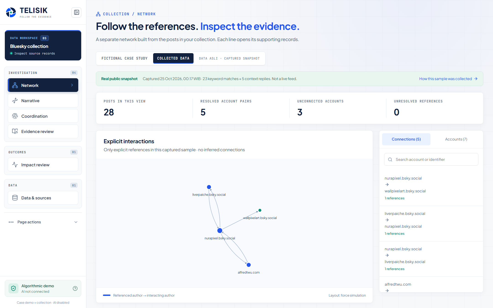
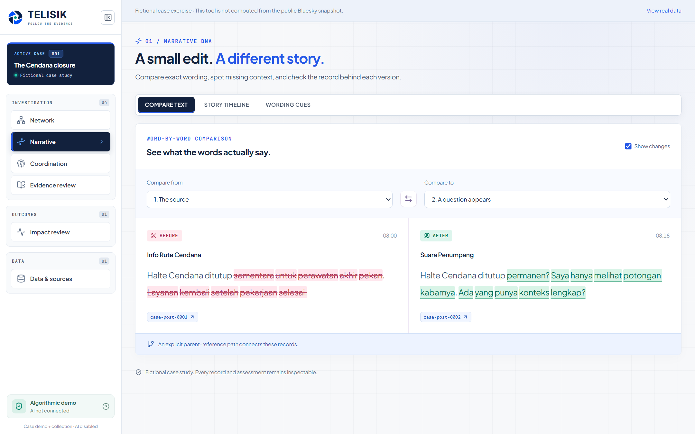
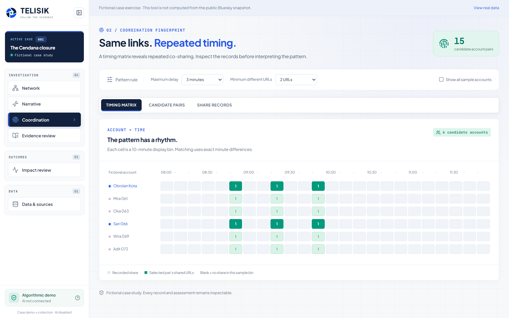
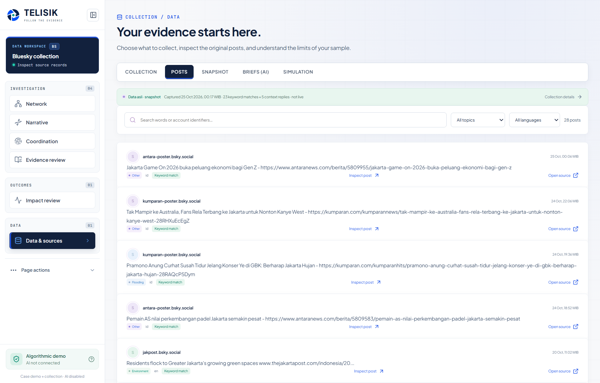
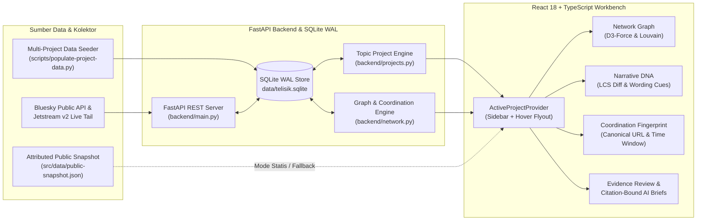

<div align="center">


# TELISIK

### **Platform Intelijen Percakapan Publik, Forensik Narasi & Verifikasi Bukti Berbasis Topik**

*Telusuri percakapan. Periksa buktinya secara presisi.*

[](https://www.typescriptlang.org/)
[](https://react.dev/)
[](https://vitejs.dev/)
[](https://fastapi.tiangolo.com/)
[](https://www.sqlite.org/)
[](https://bsky.network/)

[Fitur Utama](#-fitur-utama--kapabilitas) •
[Galeri Antarmuka](#-galeri-antarmuka--visual-walkthrough) •
[Arsitektur Sistem](#-arsitektur-sistem--alur-data) •
[Instalasi Cepat](#-instalasi--menjalankan-secara-lokal) •
[Populasi Data Project](#-populasi-data-project-real-scale-seeder) •
[Pengujian](#-pengujian--validasi)

</div>

---



## Ringkasan Eksekutif

**TELISIK** adalah ruang kerja (*workbench*) analitik dan forensik informasi publik yang dirancang untuk membantu tim analis, peneliti kebijakan publik, dan pemeriksa fakta memantau isu secara terfokus berbasis **Proyek Pemantauan Topik (*Topic Projects*)**.

Berbeda dari dasbor media sosial konvensional yang hanya menghitung volume keramaian atau mengandalkan klaim "kotak hitam" (*black-box AI*), **TELISIK** menerapkan prinsip **Keterlacakan Bukti 100% (*Evidence-First Telemetry*)**:

1. **Pemantauan Berbasis Project Topik**: Setiap isu (mis. *Banjir & Drainase Jakarta*, *Integrasi MRT & Transjakarta*, *Kualitas Udara*, *Layanan Publik & Verifikasi Hoaks*) dikelola dalam project tersendiri dengan daftar kata kunci (*keywords*) khusus.
2. **Graf Interaksi Eksplisit**: Garis koneksi antar akun hanya dibentuk dari referensi balasan (*reply*) dan kutipan (*quote*) nyata yang memiliki `AT-URI` terverifikasi—bukan sekadar kemiripan teks spekulatif.
3. **Forensik Pergeseran Kata (*Narrative DNA*)**: Melacak mutasi kalimat kata demi kata menggunakan algoritma *Longest Common Subsequence* (LCS) dan mendeteksi penghilangan kualifikasi waktu (mis. kata *"sementara"* yang berubah menjadi klaim *"permanen"*).
4. **Deteksi Pola Koordinasi Transparan**: Mengidentifikasi pasangan akun dan klaster yang menyebarkan tautan kanonis atau teks identik dalam jendela waktu sempit (detik/menit).
5. **Laporan AI Brief Terikat Sitasi**: Menyusun draf laporan kajian integritas informasi di mana setiap temuan wajib merujuk ke ID rekaman bukti asli (`[1]`, `[2]`, dst.) dan dapat diekspor ke format Markdown (`.md`).

---

## Fitur Utama & Kapabilitas

<table>
  <tr>
    <td width="50%" valign="top">
      
      <h3>1. Proyek Pemantauan Topik & Graf Jaringan</h3>
      <p>
        Kelola berbagai topik pemantauan secara independen. Beralih antar project langsung dari <em>sidebar</em> (termasuk lewat <em>hover flyout</em> saat sidebar dilipat) untuk menginspeksi graf interaksi akun, klaster komunitas <strong>Graphology Louvain</strong>, dan jembatan penyebaran informasi.
      </p>
    </td>
    <td width="50%" valign="top">
      
      <h3>2. Narrative DNA & Wording Cues</h3>
      <p>
        Bandingkan empat tahap evolusi wacana secara berdampingan (<em>Before vs After</em>). Dilengkapi <strong>Indikator Pergeseran Kata (Wording Cues)</strong> berbahasa Indonesia serta inspeksi fragmen frasa yang dihapus vs ditambahkan secara presisi.
      </p>
    </td>
  </tr>
  <tr>
    <td width="50%" valign="top">
      
      <h3>3. Coordination Fingerprint</h3>
      <p>
        Uji indikasi amplifikasi terstruktur menggunakan matriks waktu (<em>Account × Time</em>) dan normalisasi URL kanonis. Sesuaikan ambang batas jeda menit dan jumlah tautan minimum secara interaktif sebelum menarik kesimpulan.
      </p>
    </td>
    <td width="50%" valign="top">
      
      <h3>4. Evidence Review & Data Workbench</h3>
      <p>
        Bandingkan klaim yang beredar dengan dokumen rujukan (<em>Source Check</em>), uji dua hipotesis bersaing di <em>Hypothesis Arena</em>, audit celah cakupan sampel (<em>Blind Spots</em>), dan susun <strong>Laporan AI Brief</strong> per project.
      </p>
    </td>
  </tr>
</table>

---

## Galeri Antarmuka & Visual Walkthrough

### 1. Ruang Kerja Proyek Pemantauan Topik (`#/projects`)
Pantau kondisi setiap isu secara instan—mulai dari jumlah post relevan, akun unik, sinyal klaster koordinasi, hingga distribusi kemunculan kata kunci per project.



---

### 2. Data & Sumber Bukti + Laporan AI Brief (`#/briefs` & `#/posts`)
Seluruh daftar post bukti, ringkasan tren, dan arsip dokumen **Laporan AI Brief** otomatis tersaring mengikuti project topik yang sedang aktif di *sidebar*. Mendukung penyimpanan banyak dokumen brief sekaligus dalam satu project.



---

### 3. Graf Interaksi & Jejak Referensi (`#/collected`)
Visualisasi graf berarah berbasis simulasi gaya (*D3-Force*) yang menampilkan rantai balasan (*reply*) dan kutipan (*quote*) antar akun pada project aktif.



---

### 4. Narrative DNA — Perbandingan Kata demi Kata (`#/dna`)
Lacak bagaimana suatu laporan warga atau pengumuman awal kehilangan konteks saat dikutip berulang kali, lengkap dengan penanda kata yang dihapus (`Dihapus / Removed`) dan ditambahkan (`Ditambahkan / Added`).



---

### 5. Coordination Fingerprint — Matriks Waktu & Pasangan Akun (`#/fingerprint`)
Inspeksi ritme pembagian tautan berulang dalam jendela waktu sempit untuk membedakan percakapan organik dari pola penjadwalan terkoordinasi.



---

### 6. Pencarian Post Bukti & Penyaringan Multi-Bahasa (`#/posts`)
Telusuri teks post asli, filter berdasarkan topik atau kata kunci, periksa `AT-URI` sumber, dan buka tautan post publik secara langsung.



---

## Arsitektur Sistem & Alur Data



### Komponen Kunci di Repositori

| Modul / Path | Deskripsi Fungsional |
| :--- | :--- |
| [`src/app-shell.tsx`](src/app-shell.tsx) | Kerangka utama aplikasi, navigasi *sidebar* yang dapat dilipat (*collapsible*), dan *hover flyout* pemilih project. |
| [`src/topic-projects.tsx`](src/topic-projects.tsx) | *State provider* project aktif (`ActiveProjectProvider`), halaman *Proyek Pemantauan Topik*, serta modal pembuatan project & koleksi data. |
| [`src/data-workspace.tsx`](src/data-workspace.tsx) | Ruang kerja *Data & Sumber Bukti* (Ringkasan & Tren, Daftar Post Bukti, dan penyusunan dokumen *Laporan AI Brief*). |
| [`src/collection-network.tsx`](src/collection-network.tsx) | Visualisasi graf jaringan interaksi project aktif beserta daftar koneksi dan akun. |
| [`src/investigation/narrative-dna.tsx`](src/investigation/narrative-dna.tsx) | Modul *Narrative DNA* (perbandingan kata demi kata, linimasa 4 tahap narasi, dan *Wording Cues*). |
| [`src/investigation/coordination-fingerprint.tsx`](src/investigation/coordination-fingerprint.tsx) | Modul *Coordination Fingerprint* (matriks waktu, kandidat pasangan akun, dan bukti pembagian tautan). |
| [`src/investigation/evidence-review.tsx`](src/investigation/evidence-review.tsx) | Modul *Evidence Review* (*Source Check*, *Hypothesis Arena*, dan *Data Gaps / Blind Spots*). |
| [`src/ui-primitives.tsx`](src/ui-primitives.tsx) | Komponen UI *reusable* terstandarisasi (`UiButton`, `UiSelect`, `UiBadge`, `UiModal`). |
| [`backend/main.py`](backend/main.py) & [`backend/projects.py`](backend/projects.py) | Server REST API FastAPI, manajemen project topik, filter kata kunci, dan integrasi database SQLite. |
| [`scripts/populate-project-data.py`](scripts/populate-project-data.py) | Skrip generator & pengumpul data skala penuh untuk mengisi keempat project default (`PRJ-01` s.d. `PRJ-04`). |

---

## Instalasi & Menjalankan Secara Lokal

### Prasyarat
- **Node.js** `v20+` atau `v22+`
- **Python** `3.11+`
- **Git**

### Opsi A — Peluncur Satu Klik (Khusus Windows)
Klik dua kali atau jalankan skrip [`scripts/start-local.cmd`](scripts/start-local.cmd) dari *Command Prompt*:
```bat
scripts\start-local.cmd
```
Skrip ini secara otomatis membuat *virtual environment* Python (`.venv`), menginstal dependensi backend & frontend, lalu menjalankan server FastAPI (`127.0.0.1:8000`) dan Vite (`127.0.0.1:5173`).

### Opsi B — Menjalankan Manual (Windows / macOS / Linux)

1. **Clone repositori & instal paket frontend:**
   ```bash
   git clone https://github.com/mocharil/TELISIK.git
   cd TELISIK
   npm install
   ```

2. **Siapkan environment Python & instal paket backend:**
   ```powershell
   python -m venv .venv
   # Windows PowerShell:
   .\.venv\Scripts\python.exe -m pip install -r backend\requirements.txt
   # macOS / Linux:
   # ./.venv/bin/pip install -r backend/requirements.txt
   ```

3. **Populasikan database SQLite dengan data project lengkap (770+ post, graf interaksi, dan klaster koordinasi):**
   ```powershell
   .\.venv\Scripts\python.exe scripts\populate-project-data.py
   ```

4. **Jalankan Backend FastAPI (Terminal 1):**
   ```powershell
   .\.venv\Scripts\python.exe -m uvicorn backend.main:app --host 127.0.0.1 --port 8000
   ```

5. **Jalankan Frontend Vite (Terminal 2):**
   ```powershell
   npm run dev -- --host 127.0.0.1 --port 5173
   ```

6. Buka **`http://127.0.0.1:5173`** di browser Anda.

---

## Populasi Data Project (Real-Scale Seeder)

Untuk kebutuhan demonstrasi maupun pengujian skala penuh tanpa harus menunggu *live stream* berjam-jam, jalankan [`scripts/populate-project-data.py`](scripts/populate-project-data.py):

```powershell
.\.venv\Scripts\python.exe scripts\populate-project-data.py
```

Skrip ini akan:
- Mengambil post publik asli dari jaringan **Bluesky** sesuai kata kunci masing-masing project (bila koneksi internet tersedia).
- Melengkapi setiap project (`PRJ-01` s.d. `PRJ-04`) dengan ratusan post percakapan berbahasa Indonesia yang realistis, rantai balasan/kutipan (`reply_to_uri` & `quote_uri`) yang membentuk graf multi-komunitas, serta gelombang amplifikasi terkoordinasi (`coordination clusters`).

| Kode | Nama Project | Fokus Topik | Cakupan Data |
| :--- | :--- | :--- | :--- |
| **`PRJ-01`** | **Banjir & Drainase Jakarta** | `Flooding` | ~291 post · 225 akun · 189 koneksi · 8 klaster |
| **`PRJ-02`** | **Integrasi MRT & Transjakarta** | `Transport` | ~200 post · 151 akun · 119 koneksi · 7 klaster |
| **`PRJ-03`** | **Kualitas Udara & Polusi Kota** | `Environment` | ~224 post · 147 akun · 114 koneksi · 6 klaster |
| **`PRJ-04`** | **Layanan Publik & Verifikasi Hoaks** | `Information Integrity` | ~222 post · 149 akun · 129 koneksi · 10 klaster |

---

## Pengujian & Validasi

Jalankan pemeriksaan tipe TypeScript, *production build*, serta rangkaian *unit & integrity test*:

```bash
# 1. Pemeriksaan tipe TypeScript
npm run typecheck

# 2. Build produksi Vite
npm run build

# 3. Pengujian backend Python (pytest)
./.venv/Scripts/python.exe -m pytest tests/backend -q
```

---

## Prinsip Etika & Batasan Metodologis

- **Bukan Klaim Kebenaran Otomatis**: Indikator pergeseran kata (*Wording Cues*) dan pola waktu (*Coordination Fingerprint*) adalah alat bantu pemeriksaan berbasis aturan leksikal dan waktu yang transparan—bukan vonis otomatis atas niat pelaku atau keaslian akun.
- **Keterlacakan Sumber**: Setiap koneksi graf dan temuan brief wajib dapat ditelusuri kembali ke rekaman post sumbernya.
- **Privasi & Keamanan Kredensial**: File database lokal (`*.sqlite*`), variabel lingkungan (`.env`), dan kredensial layanan dikecualikan secara ketat melalui [`.gitignore`](.gitignore).

---

<div align="center">

**TELISIK — Public Signal & Evidence Intelligence**  
Dibangun untuk transparansi bukti, ketelitian analisis narasi, dan ketahanan informasi publik.

</div>
